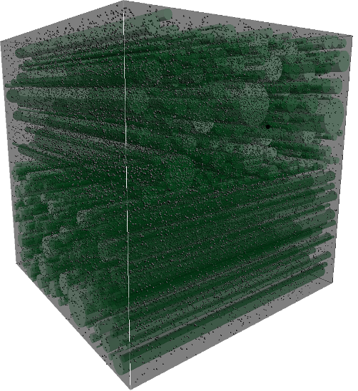

# dSim — GPU Monte Carlo simulator for diffusion MRI

<p align="center">
  
</p>

**dSim** simulates the Brownian motion of water molecules as they diffuse through
a model of white-matter tissue, and computes the diffusion-weighted MR signal
those water molecules would produce. It works like a virtual NMR sample, or one voxel
of an MRI scan: you describe the tissue geometry and the diffusion-weighting
pulse sequence, and dSim tells you what the scanner would measure.

It was written around 2009 at Stanford's [VISTA lab](https://vistalab.stanford.edu/), during the early days of
NVIDIA CUDA. Each of the 100,000+ spin-packets is an independent random walker,
so the problem maps well onto GPU threads.
The simulator was used to build the quantitative tissue model in
[Stikov et al., *NeuroImage* 2011](#publication), which links diffusion
anisotropy (FA) to fiber volume fraction and, together with quantitative
magnetization transfer, gives an estimate of the myelin **g-ratio** *in vivo*.

The image above is dSim's live OpenGL view of a simulated voxel. It is filled
with parallel fibers of varying caliber (green), and each black dot is a
diffusing spin-packet.

---

## What it does

1. **Builds a tissue model.** Fibers are infinitely long cylinders, each with
   its own position and radius, packed into a cubic voxel. You can load them from a
   `.fibers` file or generate them from a mean/stdev radius and spacing. There is
   optional support for crossing fibers and an inner (axon) radius fraction to
   represent a myelin sheath.
2. **Diffuses spins.** At each timestep, every spin-packet takes a step of fixed
   length in a random direction. The step length is set by the local diffusivity. Intra-axonal, extra-axonal, and myelin compartments each have their own diffusivity.
   When a step would cross a membrane, the spin crosses it with probability
   `10^permeability` and is bounced back otherwise. A uniform grid of cubes,
   each holding a list of the fibers it overlaps, means each spin only has to
   check nearby fibers.
3. **Plays out a pulse sequence.** A pulsed-gradient spin-echo
   (Stejskal–Tanner) sequence is applied: each spin accumulates phase in
   proportion to its position and the gradient waveform (δ, Δ, readout, and
   G<sub>x,y,z</sub>).
4. **Reads out the signal.** The phase is summed over all spins to give the
   normalized MR signal for each gradient direction. A diffusion tensor fit in
   MATLAB then gives ADC, axial and radial diffusivity, and FA.

Spin dynamics run in CUDA kernels on the GPU (`dSim2/src/spinKernel.cu`,
`dSim2/src/spinSystem.cu`). There is a CPU fallback (`dSim2/src/spinKernelCpu.cpp`), and an optional
real-time OpenGL/GTK view of the spins (the image above).

## Quantitative results: the corpus callosum tissue model

The validated quantitative use of dSim is the tissue model in Section 4 of
Stikov et al. (2011). The inputs and outputs in this repository map onto the
paper as follows.

**Tissue geometry from histology.** Fiber calibers were sampled from the
electron-microscopy caliber distributions of Aboitiz et al. (1992) for five
callosal segments: genu, anterior body, mid body, posterior body, and splenium.
Calibers were scaled by 1.5 to correct for fixation shrinkage
(`dSim2/analysis/dSimGenerateCCFibers.m`). Fibers were placed largest-first at random
positions, at least 0.05 µm apart. N, the number of fibers, was varied to cover
a range of packing densities. The pre-generated fiber sets are in
[`dSim2/fibers/`](dSim2/fibers). For example, `genu_070.fibers` …
`genu_110.fibers` contain the genu distribution at 0.70× to 1.10× the
histological density. They were written by
`dSim2/analysis/dSimGenerateCallosalFibers.m`.

**Simulation parameters (as reported in the paper).**

| Parameter | Value |
|---|---|
| Spin-packets | 100,000 |
| Timestep | 0.01 ms |
| Intra-axonal diffusivity | 1.6 µm²/ms |
| Extra-axonal diffusivity | 2.1 µm²/ms |
| Pulse sequence | δ = 18 ms, Δ = 20 ms, \|G\| = 40 mT/m (matched to the in-vivo DTI protocol) |
| Hardware | NVIDIA Tesla, CUDA |

**Key findings from the simulations.**

* **FA depends on fiber volume fraction, not on caliber.** If you plot FA against fiber
  *count*, the five caliber distributions give clearly different curves. If you plot it
  against the **fiber volume fraction**, the curves nearly coincide:

  &nbsp;&nbsp;&nbsp;&nbsp;FVF = Σ π r<sub>n</sub>² / d²

  The largest FA difference between any two caliber distributions was 5%,
  which is smaller than the in-vivo measurement noise.
* **A single calibration curve maps FA to FVF.** Pooling all five distributions
  gives a quadratic fit:

  &nbsp;&nbsp;&nbsp;&nbsp;**FVF = 0.883·FA² − 0.082·FA + 0.074**

* **The g-ratio follows when you combine this with qMT.** The bound pool fraction gives the myelin
  volume fraction (MVF ≈ 2.5 × BPF, from Dula et al. 2010). Combining that with
  the FVF from FA gives a parameter-free estimate of the axon-to-fiber diameter
  ratio:

  &nbsp;&nbsp;&nbsp;&nbsp;**g = √(1 − MVF / FVF)**

* **Applied to five healthy volunteers**, the model estimates that axons plus
  myelin take up **44–61%** of corpus callosum volume. The g-ratio comes out
  near the theoretical optimum of ~0.6. Estimates by segment (paper, Fig. 7):

  | | Genu | Ant. Body | Mid Body | Post. Body | Splenium |
  |---|---|---|---|---|---|
  | FVF | 0.45 | 0.44 | 0.45 | 0.46 | 0.60 |
  | g-ratio | 0.55 | 0.58 | 0.62 | 0.64 | 0.72 |

**Reproducing the simulations.** `dSim2/sim_paper.cfg` and
`dSim2/sim_paper.grads` hold the settings in the table above. The gradient
table has one b = 0 measurement plus 12 directions with δ = 18 ms,
Δ = 20 ms and \|G\| = 40 mT/m. To run every callosal fiber set with them:

```bash
cd dSim2
./runSimDensity.sh gpu data/densityTest_paper.m
```

Analyze the results with `dSim2/analysis/analyzeDensity.m` (tensor fit, FA vs.
density, myelin volume), which uses `dSim2/analysis/dSimFitTensor.m`. The
plain `sim.cfg` and `sim.grads` are small example settings for interactive use
and do not match the paper.

## Repository layout

```
dSim2/            The simulator used for the published results  ← start here
  src/            C++/CUDA source (spin kernels, radix sort, OpenGL renderer, GTK GUI)
  analysis/       MATLAB: fiber generation, tensor fitting, plotting
  fibers/         Pre-generated corpus-callosum fiber sets (5 segments × densities)
  data/           MATLAB-format result logs and validation runs
  doc/            Early write-up, slides and figures
  sim.cfg         Example configuration (libconfig format)
  sim.grads       Example diffusion-gradient table
  sim_paper.*     Configuration and gradients matching Stikov et al. 2011
  runSim*.sh      Batch scripts for parameter sweeps
dSim3/            Experimental branch (triangle-mesh fibers, R-tree collision
                  detection). Never fully validated: do not use for quantitative work.
```

## Input files

**Configuration (`sim.cfg`)** is a [libconfig](https://hyperrealm.github.io/libconfig/)
file with three groups:

* `app`: `useGpu`, `useDisplay`, `stepsPerUpdate`
* `sim`: `numSpins`, `timestep` (ms), `extraAdc` / `intraAdc` / `myelinAdc`
  (µm²/ms), `spaceScale` (half-width of the voxel in µm), `permeability`
  (log₁₀ transmission probability), `gradsFile`
* `fibers`: `file`, or generator parameters `radiusMean`, `radiusStdev`,
  `spacingMean`, `spacingStdev`, `innerRadiusFraction`, `crossFraction`

**Gradients (`.grads`)** have one diffusion-weighted measurement per line,
with columns `δ Δ readout Gx Gy Gz`. Times are in ms and gradients in mT/m:

```
18.00 19.31 1.00 36.0 36.0 0.0
```

**Fibers (`.fibers`)** have one cylinder per line: `x y z radius` in µm. `INF` for a
coordinate means the cylinder runs along that axis through the whole voxel.

```
38.56  70.84  INF  2.84
```

## Building and running (historical)

> **Heads-up:** these kernels were written for CUDA 2.x in 2009, back when
> "GPGPU" still drew puzzled looks, `cutil` was the SDK's standard helper
> library, and a GeForce 8800 was serious scientific hardware. The Makefile
> targets that era: the old SDK layout (`cutil`, `paramgl`), `sm_13`, GTK+ 2 and
> GtkGLExt. Building it on a modern toolchain will need some porting, such as
> replacing `cutil` and updating the arch flags and the GTK dependency.

Original dependencies: CUDA toolkit and SDK, libconfig++, GLUT/GLEW, GTK+ 2,
and gtkglext.

```bash
cd dSim2
make                       # builds bin/release/diffusion
./bin/release/diffusion -config=sim_paper.cfg -gpu -nodisp \
    -fibersFile=fibers/genu_090.fibers -out=data/results.m
```

Command-line flags override the config file: `-gpu`/`-cpu`, `-disp`/`-nodisp`,
`-numSpins=N`, `-spaceScale=S`, `-fibersFile=F`, `-radiusMean=R`,
`-spaceMean=S`, `-crossFraction=C`, `-out=FILE`. Results are *appended* to
`FILE` as a MATLAB script. Running the script loads `mrSig`, `dwGrads`,
`delta`, `Delta`, and so on, ready for `dSimFitTensor`.

## Publication

If you use dSim, please cite:

> Stikov N, Perry LM, Mezer A, Rykhlevskaia E, Wandell BA, Pauly JM, Dougherty RF.
> **Bound pool fractions complement diffusion measures to describe white matter
> micro and macrostructure.** *NeuroImage*. 2011;54(2):1112–1121.
> doi:[10.1016/j.neuroimage.2010.08.068](https://doi.org/10.1016/j.neuroimage.2010.08.068) ·
> PMID: [20828622](https://pubmed.ncbi.nlm.nih.gov/20828622/)

The full text is open access on PubMed Central:
[PMC2997845](https://pmc.ncbi.nlm.nih.gov/articles/PMC2997845/).

```bibtex
@article{stikov2011bpf,
  title   = {Bound pool fractions complement diffusion measures to describe
             white matter micro and macrostructure},
  author  = {Stikov, Nikola and Perry, Lee M. and Mezer, Aviv and
             Rykhlevskaia, Elena and Wandell, Brian A. and Pauly, John M. and
             Dougherty, Robert F.},
  journal = {NeuroImage},
  volume  = {54},
  number  = {2},
  pages   = {1112--1121},
  year    = {2011},
  doi     = {10.1016/j.neuroimage.2010.08.068}
}
```

## Authors

Robert F. Dougherty and Bragi Sveinsson (Stanford University), with
contributions from Nikola Stikov and Aviv Mezer on the corpus callosum tissue
model.

Copyright © 2011 Robert Dougherty and Bragi Sveinsson. Portions of the build
system and radix sort are derived from NVIDIA CUDA SDK sample code and remain
under NVIDIA's license terms (see file headers).
